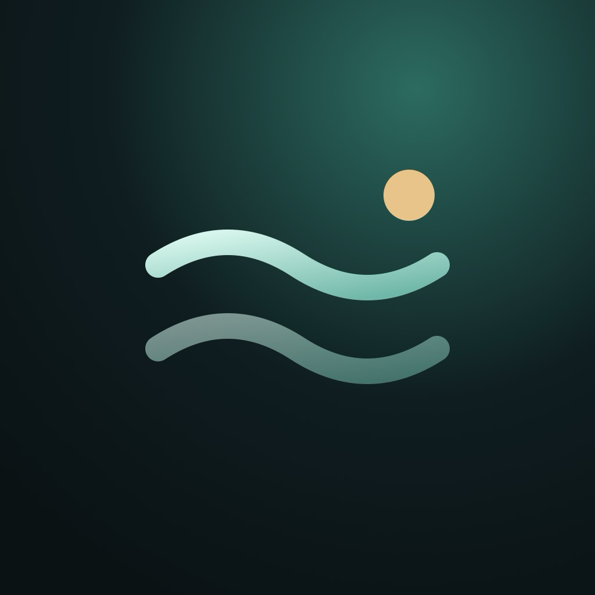
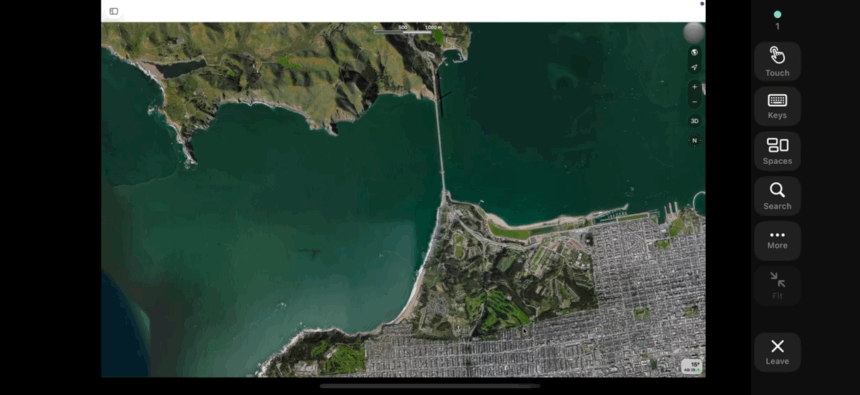
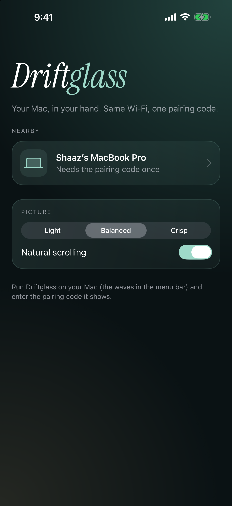
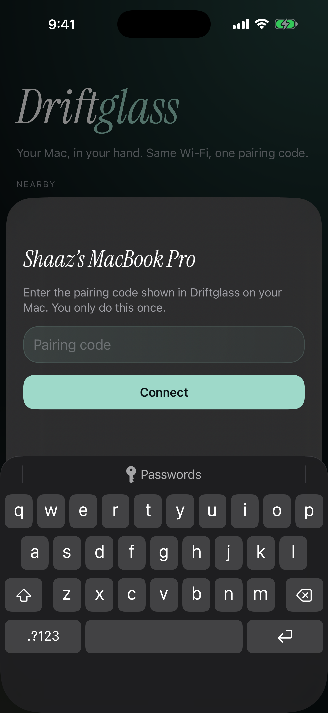
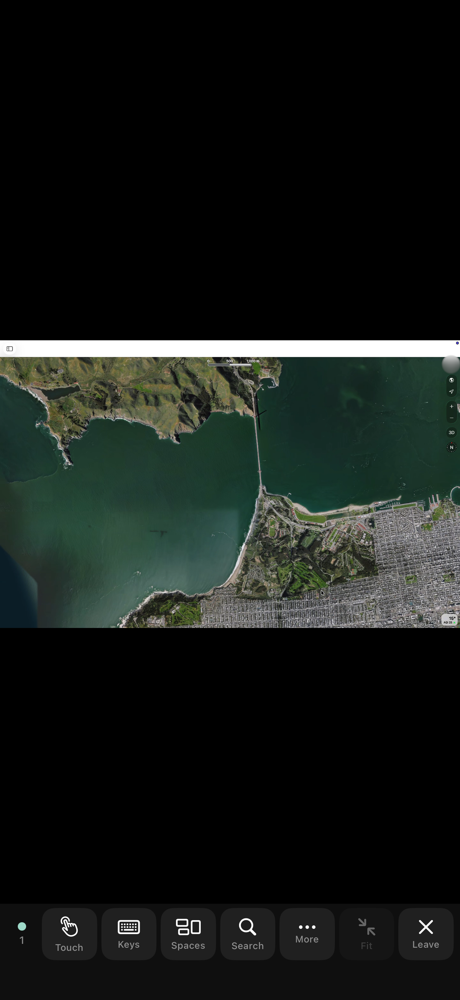
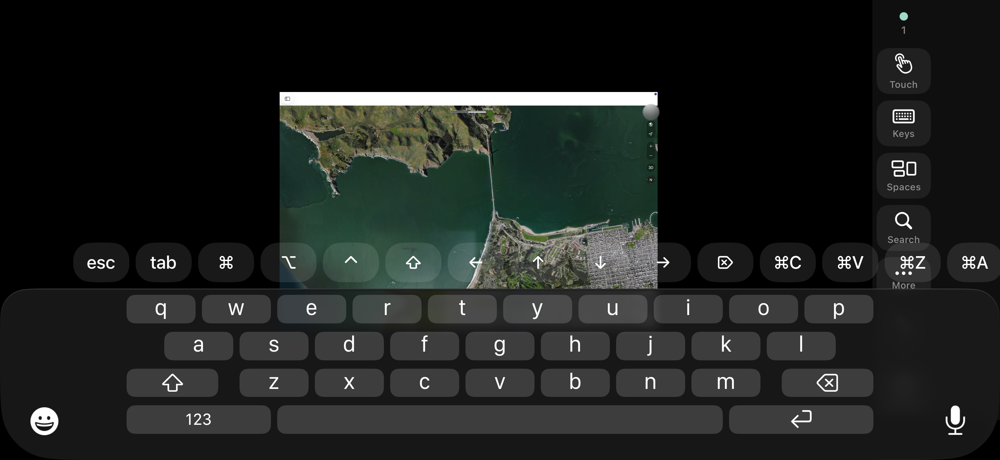
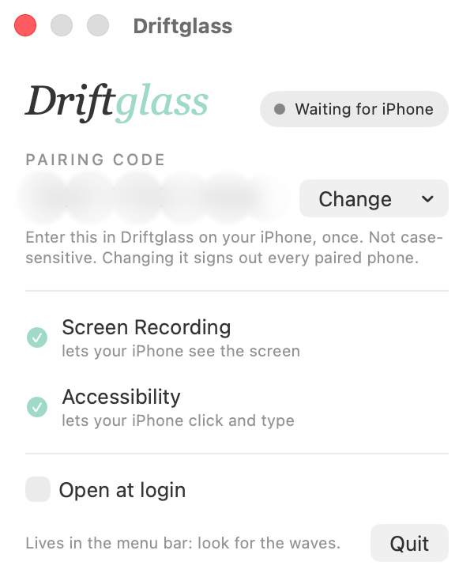
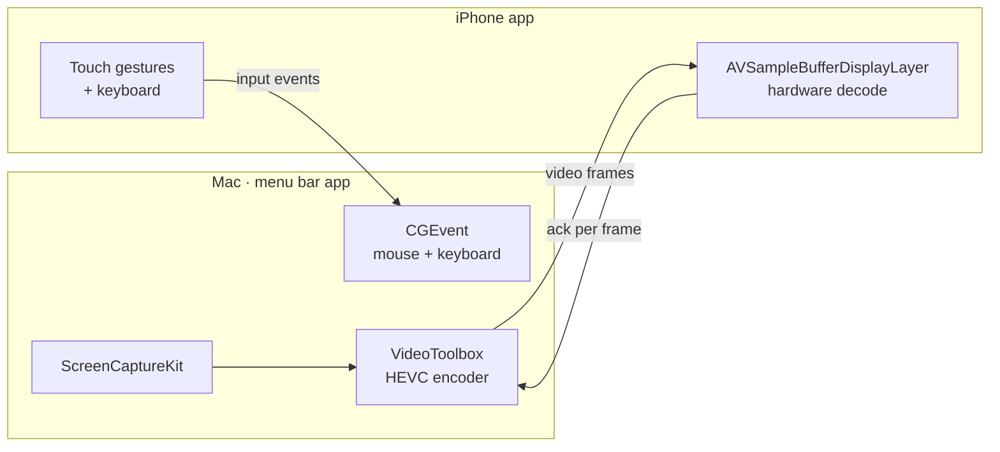
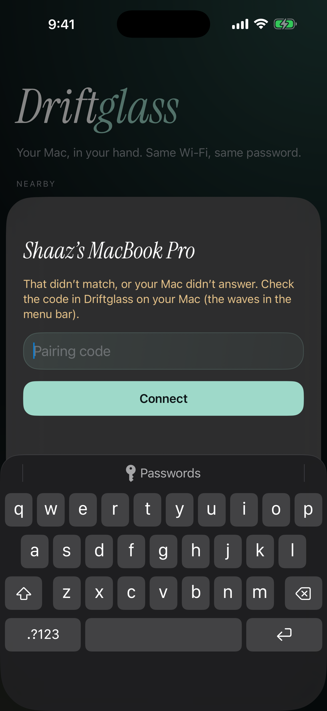
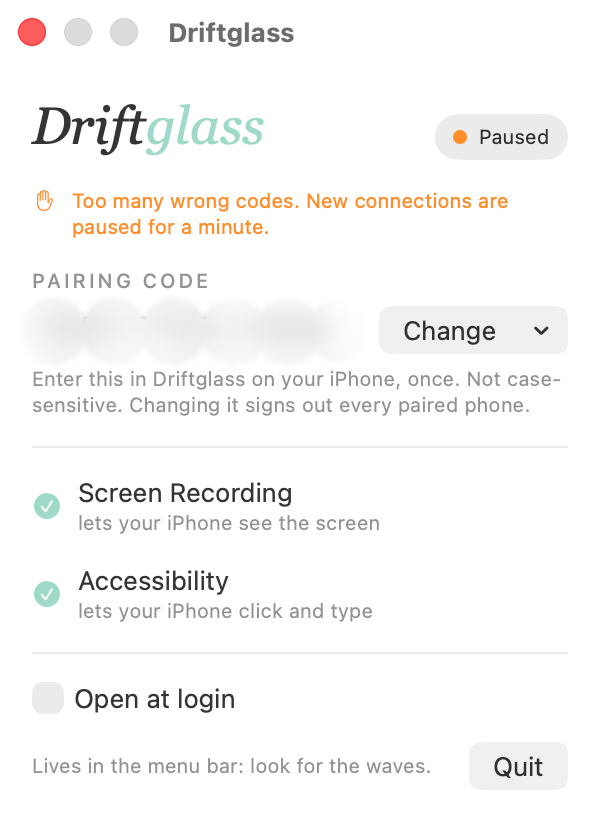

<p align="center">
  
</p>

<h1 align="center">Driftglass</h1>

<p align="center"><em>Your Mac, in your hand.</em><br>
iPhone Mirroring, the other way round: see your Mac's screen live on your iPhone and control it by touch.</p>

<p align="center">
  
</p>

Same Wi‑Fi, one pairing code, and your phone becomes a window onto your Mac. Tap to click, swipe to
scroll, hold to drag, and type with the iPhone keyboard. The picture is hardware‑encoded HEVC at
up to 60 fps, so it feels like the screen is right there.

## Screenshots

| Find your Mac | Pair once | Portrait |
|---|---|---|
|  |  |  |




<p align="center"></p>

## What it does

- **Live screen**: ScreenCaptureKit captures the Mac's display, VideoToolbox encodes it in hardware as
  HEVC, and the iPhone decodes it in hardware straight into an `AVSampleBufferDisplayLayer`.
  Frames are paced by acknowledgements from the phone, so a busy network lowers the frame rate
  instead of adding lag, and the latest change always gets through.
- **Two ways to point**
  - **Touch**: works like touching the Mac's screen. Tap to click where you tap, drag to scroll,
    press and hold then move to drag.
  - **Trackpad**: the whole phone becomes a trackpad with pointer acceleration.
- **Real trackpad scrolling**: scroll events carry trackpad phases and momentum, so apps scroll
  smoothly, rubber‑band and coast.
- **Pinch to zoom** into the picture to read small text, and pan with two fingers while zoomed.
- **Keyboard** with ⌘ ⌥ ⌃ ⇧, esc, tab, arrows and common shortcuts above the iPhone keyboard.
- **Fixed control rail** that lives in the margin beside the picture, so it never covers the screen
  and taps on it never reach the Mac. It has Touch/Trackpad, Keys, Spaces (Mission Control),
  Search (Spotlight), More (app switcher, desktop, media, volume, screenshot, lock), Fit and Leave.
- **Finds your Mac automatically** over Bonjour, pairs once with a code, and reconnects when you
  come back to the app.

### Gestures

| Gesture | Touch mode | Trackpad mode |
|---|---|---|
| Tap | Click where you tap | Click |
| Two‑finger tap | Right click there | Right click |
| One‑finger drag | Scroll | Move the pointer |
| Press, hold, move | Drag | Drag |
| Two‑finger drag | Scroll (pan when zoomed) | Scroll (pan when zoomed) |
| Pinch | Zoom the picture | Zoom the picture |
| Three‑finger swipe | ← → switch Spaces · ↑ Mission Control · ↓ desktop | same |

## How it works



- **Discovery**: the Mac advertises `_driftglass._tcp` over Bonjour and the phone browses for it.
- **Transport**: one TCP connection inside TLS 1.2 with a **pre‑shared key derived from the
  pairing code** (see [Security](#security)). Everything on the wire is encrypted. Messages are `[type u8][length u32][payload]`
  (see [`Shared/Wire.swift`](Shared/Wire.swift)).
- **Why not iCloud pairing?** Recognising "same Apple ID" is reserved for Apple's own Continuity
  features and needs entitlements a free developer account can't get. A pairing code works
  everywhere and also keys the encryption.

## Build and run

Requirements: macOS 14+, iOS 17+, Xcode (built and tested with Xcode 27), and [XcodeGen](https://github.com/yonaskolb/XcodeGen)
(`brew install xcodegen`).

```sh
git clone https://github.com/shaaz1000/driftglass.git
cd driftglass
# Set DEVELOPMENT_TEAM in project.yml to your own team ID, then:
xcodegen generate
open Driftglass.xcodeproj
```

1. Run the **DriftglassMac** scheme. A waves icon appears in the menu bar, and opening the app again
   shows its window.
2. Grant **Screen Recording** (to see the screen) and **Accessibility** (to click and type) when
   asked, or use the **Allow** buttons in the window.
3. Run the **Driftglass** scheme on your iPhone, tap your Mac, and enter the pairing code the Mac shows.

From the command line:

```sh
xcodebuild -scheme DriftglassMac -configuration Release -derivedDataPath build build
cp -R build/Build/Products/Release/Driftglass.app /Applications/

xcodebuild -scheme Driftglass -configuration Release -destination 'id=<your-iphone-udid>' \
  -derivedDataPath build -allowProvisioningUpdates build
xcrun devicectl device install app --device <your-iphone-udid> build/Build/Products/Release-iphoneos/Driftglass.app
```

> Apps signed with a free (Personal Team) account expire after 7 days on the phone. Rebuild and
> reinstall to refresh, or use a paid developer account.

## Security

Driftglass can see your screen and click and type for you, so pairing is built to be hard to abuse:

- **Strong pairing codes.** The Mac generates a random code such as `K7QM-2XRP-9HWD` (60 bits; no
  look-alike characters; not case-sensitive). You can choose your own instead, 8 characters minimum.
- **Slow key derivation.** The code is stretched with PBKDF2-HMAC-SHA256 (600,000 rounds) and a
  random per-Mac salt into the TLS pre-shared key, so a recorded handshake can't be brute-forced
  quickly.
- **Encrypted and authenticated.** TLS 1.2 PSK (`TLS_PSK_WITH_AES_128_GCM_SHA256`). A phone with the
  wrong code fails the handshake and never gets a single frame or event through.
- **Pinned Macs.** Each Mac has a permanent ID. The phone remembers the ID and salt it paired with
  and only reconnects to that exact Mac. Another device using the same name shows up as a new,
  unpaired Mac. A rejected handshake never erases a saved pairing.
- **Rate limiting.** After 20 failed handshakes in a minute (about five wrong tries from a phone),
  the Mac refuses new connections for a minute. Unauthenticated connections are dropped after
  10 seconds and can't kick off the phone that's already connected.
- **Secrets in the Keychain.** The Mac keeps its code in the Keychain. The phone stores only the
  derived key, marked this-device-only so it isn't backed up or synced.
- **Hardened Runtime** is on for the Mac app, so other software can't inject code into it and
  borrow its Screen Recording and Accessibility permissions.
- **Changing the code** rotates the salt, which signs out every paired phone.

<p align="center">
  
  &nbsp;&nbsp;
  
</p>

Known limits: TLS 1.2 PSK has no forward secrecy, so someone who records your traffic *and*
later learns your code could decrypt that recording. The very first pairing trusts the salt the
Mac advertises. One phone is connected at a time.

## Project layout

```
project.yml          XcodeGen spec for both apps
Shared/Wire.swift    protocol: framing, message types, TLS-PSK parameters
Shared/Security.swift pairing codes, key derivation, Keychain
Mac/                 menu bar host: capture + encode (Streamer), network (Host), input (Input)
iOS/                 iPhone app: discovery + decode (Session), touch surface (ScreenView), UI
iOS/Demo.swift       Debug-only launch flags used to capture the screenshots and demo video
media/               launch assets: screenshots, demo videos, icons
tools/media.swift    the helper that rotated, trimmed and blurred the demo footage
```

## Launch assets

Everything in [`media/`](media) is free to use for posts, launch pages and videos:

- `screenshots/`: full‑resolution iPhone 17 Pro Max and macOS captures, including a wrong
  code (`07-wrong-code.png`) and the Mac pausing after repeated wrong codes (`08-paused.png`)
- `video/demo-iphone.mp4`: the iPhone view (2868×1320, about 8 s)
- `video/demo-mac.mp4`: the same moment recorded on the Mac (2880×1800), for side‑by‑side edits
- `video/demo.gif`: the README loop
- `brand/`: app icons (1024 px) and the SVG source

## Limitations

- Mirrors the main display only.
- No audio.
- Local network only: no relay over the internet.

## License

[MIT](LICENSE). Instrument Serif is used under the [SIL Open Font License](iOS/Resources/OFL.txt).
