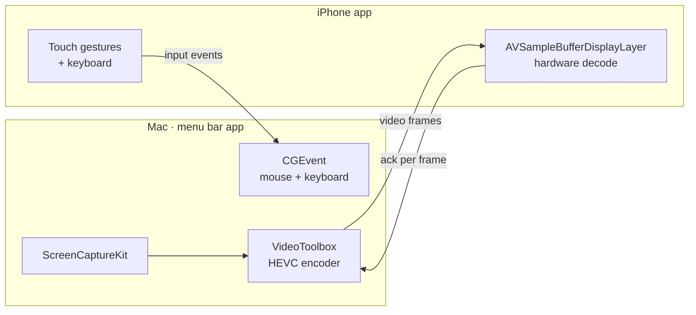

<p align="center">
  
</p>

<h1 align="center">Driftglass</h1>

<p align="center"><em>Your Mac, in your hand.</em><br>
iPhone Mirroring, the other way round: see your Mac's screen live on your iPhone and control it by touch.</p>

<p align="center">
  
</p>

Same Wi‑Fi, same password, and your phone becomes a window onto your Mac. Tap to click, swipe to
scroll, hold to drag, and type with the iPhone keyboard. The picture is hardware‑encoded HEVC at
up to 60 fps, so it feels like the screen is right there.

## Screenshots

| Find your Mac | Pair once | Portrait |
|---|---|---|
|  |  |  |


<p align="center"></p>

## What it does

- **Live screen**: ScreenCaptureKit captures the Mac's display, VideoToolbox encodes it in hardware as
  HEVC, and the iPhone decodes it in hardware straight into an `AVSampleBufferDisplayLayer`.
  Frames are paced by acknowledgements from the phone, so a busy network lowers the frame rate
  instead of adding lag, and the latest change always gets through.
- **Two ways to point**
  - **Touch**: works like touching the Mac's screen. Tap to click where you tap, drag to scroll,
    press and hold then move to drag.
  - **Trackpad**: the whole phone becomes a trackpad with pointer acceleration.
- **Real trackpad scrolling**: scroll events carry trackpad phases and momentum, so apps scroll
  smoothly, rubber‑band and coast.
- **Pinch to zoom** into the picture to read small text, and pan with two fingers while zoomed.
- **Keyboard** with ⌘ ⌥ ⌃ ⇧, esc, tab, arrows and common shortcuts above the iPhone keyboard.
- **Fixed control rail** that lives in the margin beside the picture, so it never covers the screen
  and taps on it never reach the Mac. It has Touch/Trackpad, Keys, Spaces (Mission Control),
  Search (Spotlight), More (app switcher, desktop, media, volume, screenshot, lock), Fit and Leave.
- **Finds your Mac automatically** over Bonjour, remembers the password in the Keychain, and
  reconnects when you come back to the app.

### Gestures

| Gesture | Touch mode | Trackpad mode |
|---|---|---|
| Tap | Click where you tap | Click |
| Two‑finger tap | Right click there | Right click |
| One‑finger drag | Scroll | Move the pointer |
| Press, hold, move | Drag | Drag |
| Two‑finger drag | Scroll (pan when zoomed) | Scroll (pan when zoomed) |
| Pinch | Zoom the picture | Zoom the picture |
| Three‑finger swipe | ← → switch Spaces · ↑ Mission Control · ↓ desktop | same |

## How it works



- **Discovery**: the Mac advertises `_driftglass._tcp` over Bonjour and the phone browses for it.
- **Transport**: one TCP connection inside TLS 1.2 with a **pre‑shared key derived from the
  password** (`TLS_PSK_WITH_AES_128_GCM_SHA256`). A phone with the wrong password fails the
  handshake, and everything on the wire is encrypted. Messages are `[type u8][length u32][payload]`
  (see [`Shared/Wire.swift`](Shared/Wire.swift)).
- **Why not iCloud pairing?** Recognising "same Apple ID" is reserved for Apple's own Continuity
  features and needs entitlements a free developer account can't get. A shared password works
  everywhere and also keys the encryption.

## Build and run

Requirements: macOS 14+, iOS 17+, Xcode (built and tested with Xcode 27), and [XcodeGen](https://github.com/yonaskolb/XcodeGen)
(`brew install xcodegen`).

```sh
git clone https://github.com/shaaz1000/driftglass.git
cd driftglass
# Set DEVELOPMENT_TEAM in project.yml to your own team ID, then:
xcodegen generate
open Driftglass.xcodeproj
```

1. Run the **DriftglassMac** scheme. A waves icon appears in the menu bar, and opening the app again
   shows its window.
2. Grant **Screen Recording** (to see the screen) and **Accessibility** (to click and type) when
   asked, or use the **Allow** buttons in the window.
3. Run the **Driftglass** scheme on your iPhone, tap your Mac, and enter the password the Mac shows.

From the command line:

```sh
xcodebuild -scheme DriftglassMac -configuration Release -derivedDataPath build build
cp -R build/Build/Products/Release/Driftglass.app /Applications/

xcodebuild -scheme Driftglass -configuration Release -destination 'id=<your-iphone-udid>' \
  -derivedDataPath build -allowProvisioningUpdates build
xcrun devicectl device install app --device <your-iphone-udid> build/Build/Products/Release-iphoneos/Driftglass.app
```

> Apps signed with a free (Personal Team) account expire after 7 days on the phone. Rebuild and
> reinstall to refresh, or use a paid developer account.

## Security notes

- It's designed for your own network. The connection is encrypted and authenticated by the
  password, but a short password can be guessed offline by someone who records the handshake on
  the same network, so use something longer than the default six digits if you share the Wi‑Fi.
- The Mac app needs Accessibility and Screen Recording, so treat its password like your login.
- One phone at a time: a new connection replaces the old one.

## Project layout

```
project.yml          XcodeGen spec for both apps
Shared/Wire.swift    protocol: framing, message types, TLS-PSK parameters
Mac/                 menu bar host: capture + encode (Streamer), network (Host), input (Input)
iOS/                 iPhone app: discovery + decode (Session), touch surface (ScreenView), UI
iOS/Demo.swift       Debug-only launch flags used to capture the screenshots and demo video
media/               launch assets: screenshots, demo videos, icons
tools/media.swift    the helper that rotated, trimmed and blurred the demo footage
```

## Launch assets

Everything in [`media/`](media) is free to use for posts, launch pages and videos:

- `screenshots/`: full‑resolution iPhone 17 Pro Max and macOS captures
- `video/demo-iphone.mp4`: the iPhone view (2868×1320, about 8 s)
- `video/demo-mac.mp4`: the same moment recorded on the Mac (2880×1800), for side‑by‑side edits
- `video/demo.gif`: the README loop
- `brand/`: app icons (1024 px) and the SVG source

## Limitations

- Mirrors the main display only.
- No audio.
- Local network only: no relay over the internet.

## License

[MIT](LICENSE). Instrument Serif is used under the [SIL Open Font License](iOS/Resources/OFL.txt).
